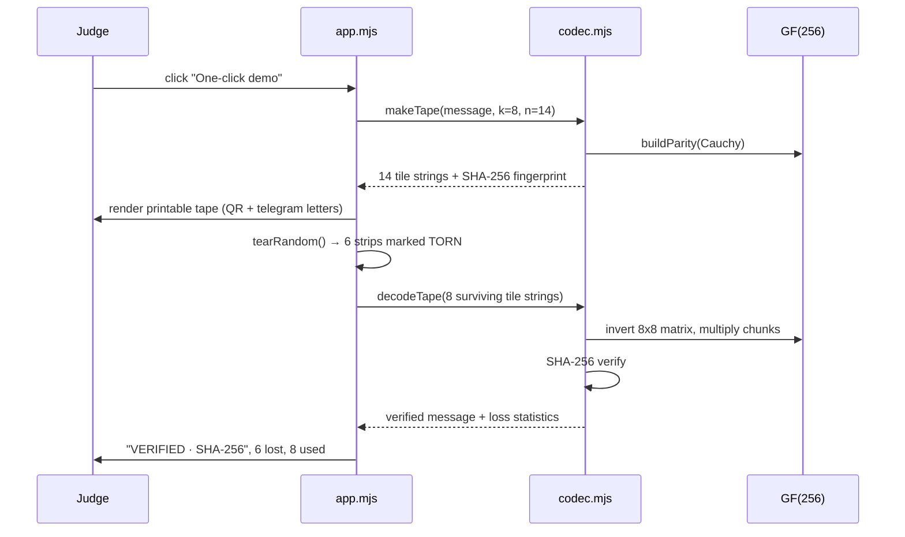

# Design — DEAD LETTER tear-tolerant tape codec

## 1. Architecture

```
message (UTF-8)
   │ TextEncoder
   ▼
padded bytes ──► k source chunks (chunkSize bytes each)
   │                      │
   │                      ├──► tiles 0..k−1 (systematic, identity rows)
   │                      │
   │  Cauchy matrix C     └──► tiles k..n−1 (parity rows)
   │  G = [ I_k ; C ]
   ▼
tile text = DL1|id|k|n|idx|len|sha16|chunkSize|base64(chunk)|crc32
   │
   ├──► QR SVG (qrcode-generator, bundled)
   ├──► human-readable telegram groups (fallback channel)
   ├──► printable tape / .deadletter JSON / clipboard
   ▼
decode: select k tiles → build k×k matrix → invert over GF(2^8)
        → multiply inverse by received chunks → trim to true length
        → SHA-256 fingerprint check → render or REFUSED
```

**Why systematic Cauchy Reed–Solomon?** A Cauchy matrix is super-regular: every
square submatrix is invertible over the field. Stacking an identity matrix above
it gives an MDS generator, so literally any k of the n rows form an invertible
system. No probabilistic fountain decoding, no "try again", no hidden failure
rate — a claim a judge can check with the property tests.

## 2. Finite field
GF(2^8) with AES polynomial 0x11D and generator 2. Precomputed `EXP[512]` and
`LOG[256]`:
- `gfMul(a,b) = EXP[LOG[a] + LOG[b]]` (0 if either is 0)
- `gfInv(a) = EXP[255 − LOG[a]]`
- `C[i][j] = gfInv(i XOR ((n−k) + j))`; the x set [0, n−k) and y set
  [n−k, n) are disjoint, so no denominator is zero.
- Inversion uses Gauss–Jordan elimination with an augmented identity matrix.

## 3. Tile format
`DL1|id|k|n|idx|length|sha16|chunkSize|base64|crc32hex` — 10 fields, ASCII
only. The CRC-32 (IEEE 802.3 polynomial 0xEDB88320) covers fields 1–9.
`sha16` is the first 8 bytes of SHA-256 of the original message bytes, hex.

## 4. Sequence — one-click demo


## 5. Error handling
| Condition | Behaviour |
| --- | --- |
| < k valid tiles | throw with exact number needed |
| bad CRC | discard tile, record `discardedLines` |
| mixed tapes | group by (id,k,n,length,fingerprint), decode largest |
| singular matrix | retry with the next k-tile window (defensive only) |
| fingerprint mismatch | throw, UI shows REFUSED |
| oversized message | reject with "split it into two tapes" |
| no camera / clipboard | paste, file and QR-image paths remain available |

## 6. Testing strategy
- Unit tests (`tests/codec.test.mjs`, `tests/gf256.test.mjs`): known CRC vector,
  round-trips, matrix inversion, error messages, file format.
- Property-based tests (`tests/pbt.test.mjs`, `fast-check`): P1–P6 from
  `requirements.md`, hundreds of generated cases per run.
- DOM smoke test (`tests/ui-smoke.test.mjs`): jsdom loads the BUILT bundle and
  runs the full compose → tear → verified revival flow.
- Compliance gate (`tools/audit-submission.mjs`): Official Rules as executable checks.
- All four run in GitHub Actions on every push and on the Pages deploy.

## 7. Deployment
`npm run build` (esbuild, IIFE) produces `public/`: index.html, styles.css,
app.js, sw.js, vendor/jsQR.js, `.nojekyll`. GitHub Actions uploads `public/`
with `actions/upload-pages-artifact` and deploys with `actions/deploy-pages`.
The service worker caches the app shell so the demo also works fully offline.

## 8. Deliberate limitations
- Integrity, not confidentiality: do not use this for secrets without adding encryption.
- Capacity: 8 KB per tape. Larger payloads need multiple tapes (a "session" feature).
- QR density: tile payloads are capped at 900 bytes so cheap printers stay scannable.
- Camera scanning needs HTTPS and permission; paste/file mode has neither requirement.
